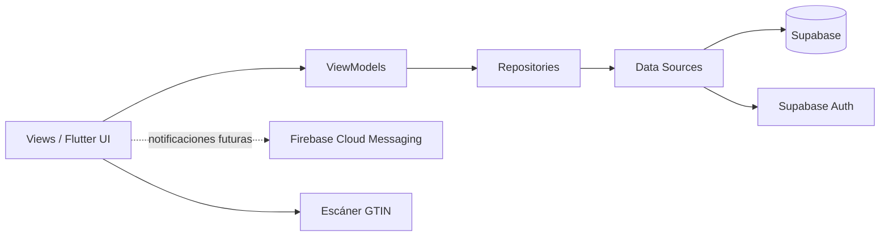

# examen-u2 — Examen práctico individual de la Unidad II

**Curso:** Soluciones Móviles II · Universidad Privada de Tacna

**Tipo de examen:** práctico individual, implementación y pruebas de una funcionalidad móvil de ubicación.

**Repositorio de entrega:** https://github.com/Wsalas651/examen-u2

**Aplicación base:** SITRA-Luz, desarrollada con Flutter/Dart.

**Alcance:** cinco apartados de 4 puntos cada uno (20 puntos).

## Historia de usuario

Como usuario de la app, quiero ver en el mapa dónde estoy y saber si estoy cerca de un lugar de interés, sin que la app agote la batería rápidamente ni se quede en blanco cuando el GPS falla.

## Cambios implementados para el examen

| Apartado | Implementación |
|---|---|
| 1. Separación de la ubicación | Entidad propia `Ubicacion` con latitud, longitud y precisión en metros. Contrato `ServicioUbicacion` inyectado en el ViewModel. Solo `ServicioUbicacionGps`, en datos, importa `geolocator`. |
| 2. Consumo y ciclo de vida | Precisión media, intervalo de 30 segundos y filtro de 50 metros. Se comprueban ambas condiciones después de la primera lectura. Sin lectura en 10 segundos se muestra «Tiempo agotado». Al salir, cubrir la pantalla o pasar a segundo plano se cancela la escucha; el servicio registra «GPS detenido». |
| 3. Precisión y alternativa manual | Mapa OpenStreetMap con atribución visible. Círculo azul cuyo radio en metros es la precisión recibida y texto «Precisión ± N m». Ante GPS apagado, permiso denegado o tiempo agotado, se informa el motivo y se permite elegir un punto tocando el mapa. |
| 4. Pruebas del ViewModel | Servicio simulado para comprobar construcción sin solicitudes, lectura en -18.0066/-70.2463 con precisión de 35 m y GPS apagado con una sola solicitud y selección manual habilitada. |
| 5. Zona de cercanía | Lugar «Clínica La Luz», centro de demostración -18.0066/-70.2463 y radio de 150 m. Distancia mediante Haversine, mensajes dentro/fuera y pruebas para puntos a aproximadamente 100 m y 300 m y para cancelación sin escuchas activas. |

El centro corresponde al ejercicio: **no es una dirección comercial verificada**. La precisión de 35 m se usa en pruebas; la app muestra la precisión que entrega Android.

## Desarrollo de las tareas de la evaluación

Los siguientes apartados detallan las tareas implementadas y las evidencias que solicita la evaluación. La implementación y las pruebas automatizadas se distinguen de las capturas que deben presentarse; una captura con ubicación simulada no se describe como lectura física ni como configuración desde controles extendidos.

### 1. Separe la ubicación del resto de la app (4 puntos)

**Objetivo:** La lógica de la pantalla obtiene la ubicación sin depender directamente de la biblioteca de GPS, de modo que pueda probarse sin GPS.

| Tarea | Trabajo realizado | Código relacionado |
|---|---|---|
| 1. Representar la ubicación con una entidad propia que incluya latitud, longitud y precisión en metros. | Se creó `Ubicacion`, con los campos `latitud`, `longitud` y `precisionMetros`. | [Entidad Ubicacion](app/lib/features/ubicacion/domain/ubicacion.dart) |
| 2. Usar la biblioteca de GPS en una única clase de datos e inyectar el servicio al ViewModel. | `ServicioUbicacionGps` es la única clase de la app que importa `geolocator`. Implementa el contrato `ServicioUbicacion`; el ViewModel lo recibe mediante `required this.servicio`, sin importar el plugin. El router construye la dependencia concreta. | [Servicio GPS](app/lib/features/ubicacion/data/servicio_ubicacion_gps.dart), [contrato](app/lib/features/ubicacion/domain/servicio_ubicacion.dart), [ViewModel](app/lib/features/ubicacion/presentation/ubicacion_viewmodel.dart), [router](app/lib/core/routes/app_router.dart) |
| 3. Mostrar latitud y longitud de una posición fijada desde los controles extendidos del emulador. | La pantalla muestra las tarjetas LATITUD y LONGITUD de la lectura recibida. La comprobación manual solicitada se realiza en Extended controls → Location; si el emulador no entrega esa lectura, se informa el tiempo agotado. La simulación alternativa de Android se documenta por separado. | [Pantalla del mapa](app/lib/features/ubicacion/presentation/mapa_ubicacion_view.dart), [guía de validación](app/GUIA_MAPA_U2.md) |

**Evidencia de la app a presentar:** captura de la pantalla con las coordenadas fijadas desde los controles extendidos del emulador. La elección manual por toque corresponde al apartado 3 y no sustituye esta comprobación.

**Evidencia del código a presentar:** captura de la entidad, de la clase de datos que usa GPS y de los imports y el constructor del ViewModel.

### 2. Pida la ubicación con precisión media y apague el GPS al salir (4 puntos)

**Objetivo:** La app no agota la batería pidiendo más ubicación de la que necesita.

| Tarea | Trabajo realizado | Código relacionado |
|---|---|---|
| 1. No utilizar la máxima precisión del GPS. | Se utiliza `LocationAccuracy.medium`; en Android se emplea el proveedor nativo con `forceLocationManager: true`. | [Servicio GPS](app/lib/features/ubicacion/data/servicio_ubicacion_gps.dart) |
| 2. Actualizar como máximo cada 30 segundos y solo ante un desplazamiento de 50 m o más. | Se configuraron `intervalDuration: Duration(seconds: 30)` y `distanceFilter: 50`. Además, después de la primera lectura se rechazan eventos si no transcurrieron 30 segundos o si el desplazamiento fue menor de 50 m. | [Ajustes y filtro del servicio](app/lib/features/ubicacion/data/servicio_ubicacion_gps.dart) |
| 3. Mostrar «Tiempo agotado» si no hay lectura en 10 segundos. | El ViewModel inicia un temporizador de 10 segundos. Cuando vence, cancela el seguimiento, guarda el motivo y habilita la elección manual; la pantalla muestra ese mensaje. | [ViewModel](app/lib/features/ubicacion/presentation/ubicacion_viewmodel.dart), [pantalla](app/lib/features/ubicacion/presentation/mapa_ubicacion_view.dart) |
| 4. Dejar de usar ubicación al salir del mapa y escribir «GPS detenido» en el log. | `didPop()` llama a `detener()` y `dispose()` libera el ViewModel. La cancelación del stream cancela las escuchas de posición y estado y ejecuta `debugPrint('GPS detenido')`. También se pausa el seguimiento al cubrir la pantalla o pasar a segundo plano. | [Ciclo de la pantalla](app/lib/features/ubicacion/presentation/mapa_ubicacion_view.dart), [detención en el ViewModel](app/lib/features/ubicacion/presentation/ubicacion_viewmodel.dart), [cancelación del servicio](app/lib/features/ubicacion/data/servicio_ubicacion_gps.dart) |

La cancelación detiene las escuchas de esta aplicación; no apaga el interruptor global de Ubicación de Android ni los servicios de otras apps.

**Evidencia de ejecución a presentar:** consola de `flutter run` o Logcat con «GPS detenido» inmediatamente después de volver desde el mapa a la pantalla anterior.

**Evidencia del código a presentar:** ajustes de precisión e intervalos, filtro de tiempo y distancia, temporizador, evento de salida y cancelación de las suscripciones, con las líneas resaltadas.

### 3. Muestre el radio de precisión y una alternativa sin GPS (4 puntos)

**Objetivo:** El usuario ve cuán exacta es su ubicación y puede seguir usando la app aunque el GPS falle.

| Tarea | Trabajo realizado | Código relacionado |
|---|---|---|
| 1. Mostrar OpenStreetMap con atribución visible. | Se usa `FlutterMap` con teselas de OpenStreetMap y la atribución visible «© OpenStreetMap contributors», enlazada a su página de copyright. | [Mapa, teselas y atribución](app/lib/features/ubicacion/presentation/mapa_ubicacion_view.dart) |
| 2. Dibujar la posición con un círculo cuyo radio sea la precisión en metros y mostrar «Precisión ± N m». | El círculo azul del usuario usa `radius: u.precisionMetros` y `useRadiusInMeter: true`. Debajo del mapa se muestra la precisión recibida. El círculo verde representa la zona del lugar, no la precisión del usuario. | [Círculo y texto de precisión](app/lib/features/ubicacion/presentation/mapa_ubicacion_view.dart) |
| 3. Mostrar el motivo de la falta de ubicación y permitir elegir tocando el mapa. | Los errores se comunican al ViewModel, que pasa a `EstadoUbicacion.eleccionMapa`. La pantalla muestra el motivo y `onTap` llama a `vm.elegir(...)`. La selección manual se identifica expresamente y no se presenta como lectura GPS ni como precisión medida. | [Errores del servicio](app/lib/features/ubicacion/data/servicio_ubicacion_gps.dart), [estado y selección](app/lib/features/ubicacion/presentation/ubicacion_viewmodel.dart), [interacción del mapa](app/lib/features/ubicacion/presentation/mapa_ubicacion_view.dart) |

**Evidencia de la app a presentar:** una captura con el círculo azul, «Precisión ± N m» y la atribución; otra con Ubicación apagada en el emulador, el motivo del fallo y un punto elegido manualmente.

**Evidencia del código a presentar:** `CircleMarker` del usuario, radio en metros, texto de precisión, presentación del motivo y `onTap`/`elegir` para la selección manual.

### 4. Ejecute tres pruebas unitarias del ViewModel de ubicación (4 puntos)

**Objetivo:** Comprobar el ViewModel sin emulador ni GPS, reemplazando el servicio de ubicación por uno simulado.

Las pruebas y el reemplazo `ServicioUbicacionSimulado` se encuentran en [ubicacion_viewmodel_test.dart](app/test/ubicacion_viewmodel_test.dart). Cada prueba recibe un ViewModel nuevo con ese servicio inyectado.

| Tarea | Trabajo realizado y resultado esperado |
|---|---|
| 1. Prueba (a): construir el ViewModel sin pedir ubicación. | `PASS 4a` verifica `solicitudes == 0`, cero escuchas activas y estado inicial después de construirlo. |
| 2. Prueba (b): lectura en -18.0066, -70.2463 y precisión de 35 m. | `PASS 4b` introduce esa lectura en el stream simulado y comprueba los tres valores expuestos y el estado `localizada`. |
| 3. Prueba (c): GPS apagado, elección en el mapa y una sola solicitud. | `PASS 4c` introduce `FalloUbicacion('GPS apagado')` y verifica `eleccionMapa`, el motivo, selección habilitada, `solicitudes == 1` y cero escuchas activas. |
| 4. Ejecutar las pruebas desde la terminal. | Las tres pruebas se ejecutaron como parte de la suite local de 49 pruebas aprobadas. El siguiente comando permite repetir únicamente estas tres. |

Desde la carpeta `app/`:

```powershell
flutter test --reporter expanded test/ubicacion_viewmodel_test.dart --name 'PASS 4[abc]:'
```

El resultado esperado es **3 pruebas aprobadas** y `All tests passed!`. La palabra PASS del nombre no basta como resultado: debe comprobarse que la ejecución finaliza sin fallos.

**Evidencia de la terminal a presentar:** captura del comando, los nombres de las tres pruebas y el resultado satisfactorio.

**Evidencia del código a presentar:** clase simulada, inyección en `setUp` y las pruebas `PASS 4a`, `PASS 4b` y `PASS 4c`. No es necesario abrir el emulador ni ejecutar `flutter run` para estas pruebas.

### 5. Avise si el usuario está cerca de un lugar y pruébelo (4 puntos)

**Objetivo:** La app avisa al usuario cuando está dentro de la zona de un lugar de interés.

| Tarea | Trabajo realizado | Código relacionado |
|---|---|---|
| 1. Marcar un lugar del negocio con zona de 150 m y avisar dentro/fuera. | Se marca «Clínica La Luz» con una zona verde de 150 m. Debajo se muestra «Estás dentro de la zona de Clínica La Luz» o «Estás fuera de la zona de Clínica La Luz», según la distancia al centro de demostración -18.0066, -70.2463. | [Lugar y cálculo](app/lib/features/ubicacion/domain/ubicacion.dart), [representación del mapa y aviso](app/lib/features/ubicacion/presentation/mapa_ubicacion_view.dart) |
| 2. Prueba (a): punto de aproximadamente 100 m dentro y punto de 300 m fuera. | `PASS 5a` comprueba las distancias y que -18.0057, -70.2463 esté dentro y -18.0039, -70.2463 esté fuera. | [Prueba de cercanía](app/test/ubicacion_viewmodel_test.dart) |
| 3. Prueba (b): ninguna escucha activa después de salir. | `PASS 5b` inicia el seguimiento, llama a `detener()`, comprueba cero escuchas e introduce una lectura posterior que ya no cambia la ubicación. Una prueba de pantalla adicional comprueba la liberación al volver de la ruta real. | [Prueba del ViewModel](app/test/ubicacion_viewmodel_test.dart), [prueba de pantalla](app/test/mapa_ubicacion_view_test.dart) |
| 4. Ejecutar las pruebas desde la terminal. | Ambas pruebas se ejecutaron como parte de la suite local aprobada. El siguiente comando permite repetirlas por separado. | [Archivo de pruebas](app/test/ubicacion_viewmodel_test.dart) |

Desde la carpeta `app/`:

```powershell
flutter test --reporter expanded test/ubicacion_viewmodel_test.dart --name 'PASS 5[ab]:'
```

El resultado esperado es **2 pruebas aprobadas** y `All tests passed!`.

**Evidencia de la app a presentar:** dos capturas que incluyan el lugar y su zona de 150 m: una con el usuario dentro y otra fuera. La referencia es el punto de demostración de Clínica La Luz, no la universidad ni el centro visible del mapa.

**Evidencia de la terminal a presentar:** comando, nombres de las pruebas `PASS 5a` y `PASS 5b` y resultado satisfactorio.

**Evidencia del código a presentar:** cálculo Haversine en `distanciaA`, comparación del radio en `contiene`, centro y radio del lugar, y las dos pruebas. Si se emplea el proveedor de prueba de Android para las capturas, se debe indicar que la ubicación fue simulada. El procedimiento está en [GUIA_MAPA_U2.md](app/GUIA_MAPA_U2.md).

## Arquitectura de la funcionalidad

```text
MapaUbicacionView
        ↓
UbicacionViewModel
        ↓ servicio recibido por constructor
ServicioUbicacion (contrato de dominio)
        ↑ implementa
ServicioUbicacionGps (capa de datos → geolocator)
```

Las pruebas reemplazan `ServicioUbicacionGps` por `ServicioUbicacionSimulado`. La entidad y el ViewModel no importan la biblioteca de GPS. La configuración del router construye e inyecta el servicio concreto.

## Archivos del proyecto móvil afectados

Todas las rutas de esta tabla son relativas a la raíz del repositorio.

| Archivo | Tipo | Cambio |
|---|---|---|
| `app/lib/features/ubicacion/domain/ubicacion.dart` | Nuevo | Entidad, cálculo de distancia y lugar de interés con zona de 150 m. |
| `app/lib/features/ubicacion/domain/servicio_ubicacion.dart` | Nuevo | Contrato del servicio y errores de dominio. |
| `app/lib/features/ubicacion/data/servicio_ubicacion_gps.dart` | Nuevo | Integración GPS, precisión media, filtros, conversión a entidad, cancelación y log. |
| `app/lib/features/ubicacion/presentation/ubicacion_viewmodel.dart` | Nuevo | Estado, inyección del servicio, tiempo límite, selección manual y cierre del seguimiento. |
| `app/lib/features/ubicacion/presentation/mapa_ubicacion_view.dart` | Nuevo | Mapa, círculos, marcadores, coordenadas, precisión, cercanía y alternativa manual. |
| `app/lib/core/routes/mapa_route_observer.dart` | Nuevo | Observación del ciclo de navegación para detener o reanudar el seguimiento. |
| `app/lib/core/routes/app_router.dart` | Modificado | Ruta pública `/mapa`, observador e inyección del servicio GPS. |
| `app/lib/core/widgets/sitra_app_bar.dart` | Modificado | Acceso al mapa desde la barra de los módulos. |
| `app/lib/features/auth/presentation/views/login_view.dart` | Modificado | Botón «Ver mapa de cercanía» disponible sin iniciar sesión. |
| `app/android/app/src/main/AndroidManifest.xml` | Modificado | Permisos de ubicación aproximada y precisa en primer plano. |
| `app/pubspec.yaml` | Modificado | Dependencias `flutter_map`, `latlong2`, `geolocator` y `url_launcher`. |
| `app/pubspec.lock` | Modificado | Resolución de dependencias de la aplicación. |
| `app/test/ubicacion_viewmodel_test.dart` | Nuevo | Servicio simulado y 10 pruebas del ViewModel, errores, cercanía y cancelación. |
| `app/test/mapa_ubicacion_view_test.dart` | Nuevo | Prueba del radio en metros, atribución, estado de cercanía y liberación al volver. |
| `app/test/servicio_ubicacion_gps_test.dart` | Nuevo | Dos pruebas del proveedor, configuración y cancelación durante un permiso pendiente. |
| `app/GUIA_MAPA_U2.md` | Nuevo | Procedimiento de validación y evidencias de los cinco apartados. |
| `app/README.md` | Modificado | Instrucciones del proyecto móvil y enlace a esta entrega. |

También se actualizó este `README.md` para identificar el examen, sus cambios y los archivos afectados. El repositorio incluye el código fuente completo de la aplicación base y estas modificaciones; las carpetas de compilación y archivos temporales locales no forman parte de la entrega.

## Clonar y ejecutar

```powershell
git clone https://github.com/Wsalas651/examen-u2.git
cd examen-u2/app
flutter pub get
flutter run
```

Requisitos: Flutter estable, Dart compatible con `^3.9.2`, Android SDK y un emulador o dispositivo Android. El entorno de validación utilizó Flutter 3.47.8 y Dart 3.13.7.

En el login pulsa **Ver mapa de cercanía**, o utiliza el icono de mapa de la barra superior de los módulos. El mapa es público y no expone datos de pacientes. La funcionalidad de ubicación **no requiere token de Google Cloud**; OpenStreetMap necesita Internet para cargar las teselas. El resto de los módulos conserva la configuración de Supabase del proyecto base.

## Comandos de pruebas

Ejecutar desde `app/`. Las pruebas no requieren GPS ni emulador.

```powershell
# Análisis estático
flutter analyze --no-pub

# Todas las pruebas del proyecto
flutter test --reporter expanded

# Las 13 pruebas nuevas del examen
flutter test --reporter expanded test/ubicacion_viewmodel_test.dart test/mapa_ubicacion_view_test.dart test/servicio_ubicacion_gps_test.dart

# Apartado 4: tres pruebas del ViewModel
flutter test --reporter expanded test/ubicacion_viewmodel_test.dart --name 'PASS 4[abc]:'

# Apartado 5: dos pruebas de zona y cancelación
flutter test --reporter expanded test/ubicacion_viewmodel_test.dart --name 'PASS 5[ab]:'

# Compilación Android de desarrollo
flutter build apk --debug --no-pub
```

Validación local realizada durante la implementación: análisis sin observaciones, **49 pruebas aprobadas en total** (13 nuevas) y APK de desarrollo compilado. Estos resultados locales no representan el estado de GitHub Actions.

## Evidencias y prueba manual

1. En **Extended controls → Location**, fija una posición y captura las coordenadas de la app.
2. Captura el círculo azul y «Precisión ± N m», conservando visible la atribución OpenStreetMap.
3. Apaga Ubicación en el emulador, abre el mapa y elige un punto mediante toque; captura el motivo y la selección manual.
4. Con `flutter run` activo, sal del mapa y captura «GPS detenido» en la consola.
5. Prueba `-18.0057, -70.2463` (dentro, aproximadamente 100 m) y `-18.0039, -70.2463` (fuera, aproximadamente 300 m). Espera al menos 30 segundos entre lecturas aceptadas o inicia una nueva escucha saliendo y entrando al mapa.
6. Captura los comandos de pruebas y el resultado `All tests passed!`, junto con las líneas de código correspondientes.

Algunas imágenes de emulador no entregan las posiciones de `geo fix` al proveedor de precisión media. Durante la validación también se usó un proveedor de prueba de Android con lecturas simuladas de 35 m; no son lecturas físicas ni coordenadas fijadas en la app. Los pasos de reproducción y restauración están en [la guía de evidencias](app/GUIA_MAPA_U2.md).

---

## Documentación del proyecto base SITRA-Luz

La siguiente documentación describe el proyecto original sobre el cual se implementó este examen individual; sus apartados de planificación conservan el contexto del proyecto base.
<p align="center">
  
</p>

<h1 align="center">SITRA-Luz</h1>

<p align="center">
  <strong>Sistema de Trazabilidad y Dispensación de Medicamentos</strong><br>
  Clínica La Luz · Tacna, Perú
</p>

<p align="center">
  Aplicación móvil desarrollada con Flutter para digitalizar el flujo interno de medicamentos,
  controlar inventario por áreas, registrar movimientos y mejorar la trazabilidad entre
  Almacén, Farmacia y áreas clínicas.
</p>

---

## Descripción

**SITRA-Luz** es una aplicación móvil orientada a la gestión y trazabilidad interna de medicamentos e insumos médicos en la Clínica La Luz.

El proyecto busca cubrir procesos que normalmente se realizan de forma manual o mediante registros dispersos, especialmente en el flujo interno:

```text
Proveedor
   ↓
Almacén General
   ↓
Farmacia Central
   ↓
Áreas clínicas / Enfermería
```

La aplicación centraliza autenticación, roles, catálogo de medicamentos, lotes, stock, transferencias, solicitudes de abastecimiento y trazabilidad, utilizando una arquitectura móvil basada en Flutter y un backend principal en Supabase.

---

## Objetivo del proyecto

Digitalizar y controlar el flujo interno de medicamentos e insumos médicos de la clínica, proporcionando:

- autenticación segura de usuarios;
- control de acceso según rol;
- catálogo centralizado de medicamentos;
- gestión de lotes y vencimientos;
- control de stock por área;
- transferencias entre Almacén y Farmacia;
- solicitudes de abastecimiento;
- registro asistido mediante lectura de códigos GTIN/GS1;
- trazabilidad de movimientos;
- soporte futuro para notificaciones push;
- base para módulos de dispensación, auditoría y reportes.

---

## Arquitectura tecnológica

El proyecto utiliza una arquitectura basada en **MVVM + Repository**, con separación entre presentación, dominio y acceso a datos.



### Flujo principal

```text
View
  ↓
ViewModel
  ↓
Repository
  ↓
DataSource
  ↓
Supabase / servicios externos
```

---

## Stack tecnológico

| Capa | Tecnología |
|---|---|
| Aplicación móvil | Flutter / Dart |
| Gestión de estado | Provider |
| Navegación | GoRouter |
| Backend principal | Supabase |
| Base de datos | PostgreSQL |
| Autenticación | Supabase Auth |
| Seguridad de datos | Row Level Security (RLS) |
| Escaneo GTIN | `mobile_scanner` |
| Captura de imágenes | `image_picker` |
| Notificaciones | Firebase Cloud Messaging |
| CI/CD | GitHub Actions |
| Control de versiones | Git / GitHub |

> **Importante:** Supabase es el backend principal del sistema. Firebase se reserva exclusivamente para notificaciones push mediante FCM y actualmente se encuentra desactivado mediante una feature flag hasta una fase posterior.

---

## Roles del sistema

SITRA-Luz contempla cinco perfiles principales:

| Rol | Responsabilidad principal |
|---|---|
| Administrador | Administración general, usuarios y configuración |
| Jefatura de Farmacia | Supervisión, control y reportes |
| Farmacia | Preparación, despacho y gestión de solicitudes |
| Almacén | Inventario, lotes, registro y transferencias |
| Enfermería / Técnico | Solicitud y recepción de medicamentos e insumos |

La aplicación utiliza el rol almacenado en la tabla `profiles` de Supabase para dirigir al usuario al módulo correspondiente.

---

## Módulos principales

### Autenticación y control de acceso

El sistema cuenta con autenticación mediante **Supabase Auth** y consulta del perfil del usuario en PostgreSQL.

Actualmente incluye:

- inicio de sesión con correo y contraseña;
- validación de credenciales;
- lectura de perfil desde `profiles`;
- identificación del rol del usuario;
- redirección mediante GoRouter;
- cierre de sesión;
- manejo de errores de conectividad;
- dashboards independientes para los cinco roles.

### Catálogo de medicamentos

El módulo de Almacén permite trabajar con el catálogo general almacenado en Supabase.

Incluye:

- consulta de medicamentos activos;
- búsqueda y filtrado;
- registro de medicamentos;
- edición de medicamentos existentes;
- información farmacéutica y de presentación;
- soporte para código GTIN;
- integración con lotes e inventario.

### Lotes e inventario

El proyecto incorpora estructuras para administrar:

- medicamentos;
- lotes;
- fechas de vencimiento;
- stock por área;
- ingresos de mercadería;
- movimientos de inventario;
- auditoría de operaciones.

La base de datos se encuentra definida mediante scripts SQL dentro de:

```text
docs/supabase/
```

### Transferencias Almacén → Farmacia

El módulo de Almacén permite registrar movimientos de stock desde Almacén General hacia Farmacia Central.

El flujo implementado contempla:

1. validar el stock disponible;
2. descontar la cantidad del Almacén;
3. incrementar o crear el stock correspondiente en Farmacia;
4. registrar el movimiento en auditoría.

> Actualmente el flujo funcional existe, pero la atomicidad completa de la operación debe reforzarse mediante una función/RPC transaccional en PostgreSQL antes de considerarlo cerrado a nivel de producción.

### Solicitudes de abastecimiento

Existe soporte para consultar y atender solicitudes provenientes de Farmacia.

Actualmente se dispone de:

- modelo de solicitud;
- tabla de solicitudes en Supabase;
- detalle de ítems;
- bandeja para Almacén;
- cambio de estado de solicitudes;
- registro de auditoría.

La creación completa de solicitudes desde el módulo de Farmacia continúa como parte del desarrollo pendiente.

### Escaneo GTIN

El proyecto incorpora lectura de códigos GTIN/GS1 utilizando la cámara del dispositivo.

Características actuales:

- lectura local del código de barras;
- funcionamiento sin necesidad de conexión durante el escaneo;
- captura opcional de imagen de la caja;
- integración con el flujo de registro de medicamentos;
- formulario de revisión y corrección.

El procesamiento real mediante Gemini todavía no se encuentra conectado a una API externa. El servicio actual utiliza datos de demostración y lógica simulada para representar el flujo de extracción.

---

## Supabase

Supabase concentra la autenticación y persistencia principal del proyecto.

Entre las estructuras utilizadas se encuentran:

```text
profiles
medicamentos
lotes
inventario_stock
pedidos_abastecimiento
pedidos_abastecimiento_items
dispensaciones
auditoria_trazabilidad
```

La configuración y scripts necesarios se encuentran en:

```text
docs/supabase/
├── GUIA_SUPABASE.md
├── crear_usuarios_roles.sql
└── setup_sitra_luz.sql
```

### Decisión arquitectónica

La arquitectura original evaluó Firebase y un modelo híbrido, pero posteriormente el proyecto consolidó:

```text
Supabase PostgreSQL
        +
Supabase Auth
        +
Firebase FCM únicamente para notificaciones
```

La decisión está documentada en:

```text
docs/decisiones/ADR-003-migracion-supabase-fcm.md
```

---

## Firebase Cloud Messaging

Firebase permanece en el proyecto exclusivamente como infraestructura para notificaciones push.

Actualmente:

```dart
NotificationService.enablePushNotifications = false;
```

Por lo tanto:

- Firebase no almacena los datos principales;
- Firebase Auth no es utilizado;
- Firestore no es utilizado como base de datos principal;
- FCM será habilitado en una etapa posterior.

---

## Estructura principal del proyecto

```text
SITRA-Luz/
├── .github/
│   └── workflows/
│       ├── ci.yml
│       └── flutter_ci.yml
│
├── app/
│   ├── android/
│   ├── assets/
│   ├── lib/
│   │   ├── core/
│   │   │   ├── config/
│   │   │   ├── routes/
│   │   │   ├── services/
│   │   │   ├── theme/
│   │   │   └── widgets/
│   │   │
│   │   ├── features/
│   │   │   ├── auth/
│   │   │   ├── almacen/
│   │   │   ├── dashboard_admin/
│   │   │   ├── dashboard_almacen/
│   │   │   ├── dashboard_enfermeria/
│   │   │   ├── dashboard_farmacia/
│   │   │   └── dashboard_jefatura/
│   │   │
│   │   └── main.dart
│   │
│   ├── test/
│   └── pubspec.yaml
│
├── docs/
│   ├── contexto/
│   ├── decisiones/
│   ├── equipo/
│   ├── producto/
│   └── supabase/
│
├── CONTRIBUTING.md
├── CONVENTIONS.md
└── README.md
```

---

## Arquitectura por feature

Las funcionalidades siguen una separación similar a:

```text
features/
└── modulo/
    ├── data/
    │   ├── datasources/
    │   ├── models/
    │   ├── repositories/
    │   └── services/
    │
    ├── domain/
    │   ├── entities/
    │   └── repositories/
    │
    └── presentation/
        ├── states/
        ├── viewmodels/
        └── views/
```

Esto permite mantener desacopladas:

- interfaz gráfica;
- lógica de presentación;
- reglas de dominio;
- persistencia;
- servicios externos.

---

## Requisitos

Para ejecutar el proyecto se recomienda contar con:

- Flutter estable;
- Dart `^3.9.2`;
- Android Studio;
- Android SDK;
- Git;
- una instancia de Supabase configurada;
- emulador Android o dispositivo físico.

El proyecto está orientado principalmente a dispositivos móviles.

Requisitos mínimos definidos por el sistema:

- Android 9 / API 28 o superior;
- iOS 14 o superior.

El desarrollo y las pruebas actuales se concentran principalmente en Android.

---

## Instalación

### 1. Clonar el repositorio

```bash
git clone https://github.com/Wsalas651/examen-u2.git
cd examen-u2
```

Para consultar una rama de desarrollo del proyecto base (si está disponible localmente):

```bash
git switch Sprint-02
```

### 2. Ingresar al proyecto Flutter

```bash
cd app
```

### 3. Instalar dependencias

```bash
flutter pub get
```

### 4. Verificar el entorno

```bash
flutter doctor
```

Para listar dispositivos disponibles:

```bash
flutter devices
```

---

## Configuración de Supabase

El proyecto utiliza:

```text
app/lib/core/config/supabase_config.dart
```

Debes configurar:

```text
SUPABASE_URL
SUPABASE_ANON_KEY
```

No utilices una `service_role` dentro de la aplicación móvil.

Después, ejecuta el script:

```text
docs/supabase/setup_sitra_luz.sql
```

desde el SQL Editor de Supabase.

También puedes consultar:

```text
docs/supabase/GUIA_SUPABASE.md
```

para revisar la configuración completa.

---

## Ejecutar la aplicación

Con un emulador o dispositivo Android conectado:

```bash
flutter run
```

Para seleccionar un dispositivo específico:

```bash
flutter devices
flutter run -d <device-id>
```

---

## Ejecutar pruebas

```bash
flutter test
```

---

## Análisis estático

```bash
flutter analyze
```

---

## Generar APK

```bash
flutter build apk --release
```

El APK generado estará disponible normalmente en:

```text
build/app/outputs/flutter-apk/app-release.apk
```

---

## Integración continua

El repositorio utiliza GitHub Actions.

### Flutter CI

El flujo principal ejecuta:

```text
flutter pub get
flutter analyze
flutter test
flutter build apk --release
```

sobre ramas como:

```text
main
develop
Sprint-*
```

### Calidad y seguridad

El proyecto también incluye verificaciones orientadas a:

- análisis estático;
- pruebas;
- cobertura;
- detección de secretos mediante Trivy.

Los workflows se encuentran en:

```text
.github/workflows/
```

---

## Seguridad

El proyecto contempla varias medidas de seguridad:

- autenticación mediante Supabase Auth;
- contraseñas administradas por el proveedor de autenticación;
- perfiles asociados a `auth.users`;
- Row Level Security en PostgreSQL;
- separación de roles;
- auditoría de operaciones;
- validación de sesiones;
- escaneo de secretos mediante CI.

No deben almacenarse en el repositorio:

- contraseñas;
- claves privadas;
- `service_role`;
- tokens personales;
- secretos de APIs externas.

---

## Estado actual

### Implementado

- [x] Proyecto Flutter operativo
- [x] Arquitectura MVVM / Repository
- [x] Supabase como backend principal
- [x] Supabase Auth
- [x] Tabla de perfiles y roles
- [x] Cinco roles de usuario
- [x] Login
- [x] Navegación con GoRouter
- [x] Dashboards por rol
- [x] Tema visual de SITRA-Luz
- [x] Catálogo de medicamentos
- [x] Registro de medicamentos
- [x] Edición de medicamentos
- [x] Gestión de lotes
- [x] Inventario de Almacén
- [x] Transferencia de stock hacia Farmacia
- [x] Auditoría de movimientos
- [x] Lectura GTIN mediante cámara
- [x] Captura opcional de imagen
- [x] Bandeja de solicitudes para Almacén
- [x] CI con GitHub Actions

### En desarrollo / mejora

- [ ] Vista consolidada completa de stock Farmacia + Almacén
- [ ] Transferencia de stock completamente atómica mediante PostgreSQL
- [ ] Creación de solicitudes desde Farmacia
- [ ] Protección estricta de todas las rutas por rol
- [ ] Integración real con Gemini
- [ ] Validación IA de medicamentos
- [ ] Activación de Firebase Cloud Messaging
- [ ] Expiración configurable de sesión

### Próximos módulos

- [ ] Fichas de pedido
- [ ] Flujo de preparación y dispensación
- [ ] Confirmación de recojo
- [ ] Descuento automático de stock
- [ ] Kits de Neonatología
- [ ] Gestión completa de usuarios
- [ ] Trazabilidad histórica
- [ ] Dashboard de Jefatura
- [ ] Alertas de stock crítico
- [ ] Gestión FEFO
- [ ] Exportación de fichas a PDF
- [ ] Integración con Google Drive

---

## Requerimientos del sistema

La documentación funcional del proyecto contempla requerimientos relacionados con:

- autenticación;
- control por roles;
- fichas de pedido;
- catálogo;
- inventario;
- lotes;
- GTIN;
- abastecimiento;
- trazabilidad;
- usuarios;
- reportes;
- PDF;
- Google Drive;
- notificaciones.

La especificación completa se encuentra en:

```text
docs/contexto/requerimientos.md
```

---

## Equipo

**Grupo 04 — Universidad Privada de Tacna**

| Integrante | Rol |
|---|---|
| Bruno Ancco Suaña | Scrum Master · Developer |
| Walter Sala Jimenez | Product Owner · Developer |
| David Anampa | Developer · QA |

Curso:

```text
Soluciones Móviles II — SI-988
```

---

## Convenciones de desarrollo

El repositorio cuenta con documentación específica para mantener consistencia durante el desarrollo:

```text
CONVENTIONS.md
CONTRIBUTING.md
```

Se recomienda utilizar Conventional Commits:

```text
feat:
fix:
docs:
refactor:
test:
build:
ci:
```

Ejemplo:

```bash
git commit -m "feat(almacen): implementar registro de lotes"
```

---

## Flujo de trabajo recomendado

```bash
git pull
git switch <rama>
git add .
git commit -m "tipo(modulo): descripcion"
git push
```

Antes de realizar un push:

```bash
cd app
flutter pub get
flutter analyze
flutter test
```

---

## Visión del proyecto

SITRA-Luz busca convertirse en una solución móvil que permita conocer:

- qué medicamento ingresó;
- a qué lote pertenece;
- cuánto stock existe;
- dónde se encuentra;
- quién realizó cada movimiento;
- cuándo ocurrió;
- hacia qué área fue transferido o dispensado.

El objetivo final es contar con una trazabilidad digital completa del medicamento dentro del flujo interno de la clínica.

---

<p align="center">
  <strong>SITRA-Luz</strong><br>
  Sistema de Trazabilidad y Dispensación de Medicamentos
</p>
